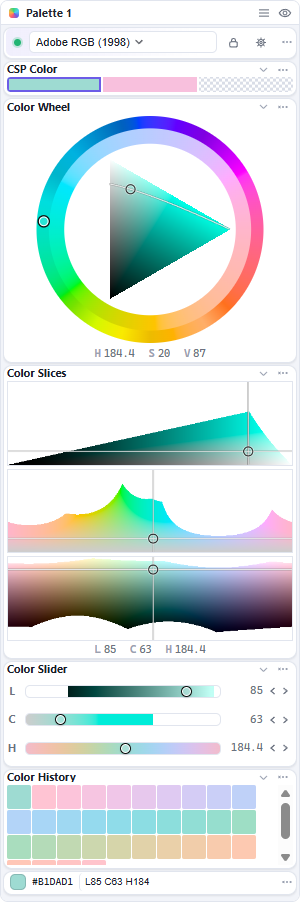

# Iroiroppa — a perceptually uniform color picker and helper tools for Clip Studio Paint

A Windows popup with a perceptually uniform color picker and a collection of helper tools for Clip Studio Paint. It connects like the official phone app — by impersonating the phone side of CSP's **Companion Mode** ("Connect to smartphone").



**New here?** The [user guide](wiki/Home.md) walks through installing, connecting
to Clip Studio Paint, picking colors and getting out of trouble — plain language,
no programming required.

## Features

- **Many color models** — OKLab/OKLCH, OKHSV, OKHSL, CIELAB/CIELCH and HelmGen/HelmGen LCH, all views over one canonical OKLab value. Appearance → **Color model family** can limit every list to one family.
- **Pick visually** — maps and sliders for hue, chroma and lightness, sent to Clip Studio Paint as you drag (or on release).
- **Two-way sync** — colors changed in Clip Studio Paint appear here, and changes here update Clip Studio Paint live.
- **Proof color** — if your document uses a color profile and CSP's *Preview color profile* is on, a perceptual picker can look uneven, because the canvas previews a different space from the recorded channel values. Set the document's profile in Iroiroppa and its maps are computed in that profile's gamut, so the picker and the proofed canvas agree. The RGB-shaped pickers (OKHSV/OKHSL) are measured inside the document's own gamut; colors the monitor cannot show are drawn clipped, and Settings → **Mark colors this display can't show** dims that region.
- **A clear readout** — the current color's hex code and channel values at a glance.
- **A modular palette** — show, hide, duplicate, resize and arrange small modules, minimize any multi-line module to its header, or pop one out into its own window.
- **Shortcuts that fit your hand** — General and each palette choose one reveal mode: toggle, hold, or after a color pick. Plain-letter keys work but are ignored while typing. A revealed window can keep its place or appear beside the pointer.
- **Shortcuts that know when to act** — global keys only fire while Clip Studio Paint or an Iroiroppa window is active.

## Modules

Each module does one job and can be shown, hidden, duplicated, resized with its settings or by dragging its bottom edge. The shipped template starts with **Session**, then **CSP Color**, **Color Wheel** (OKHSV), **Color Slices** (OKLCH), **Color Slider** (OKLCH), **Color History** and **Color Stat**.

- **Session** — the connection light (its tooltip says “Connected to Clip Studio Paint”), a dropdown for the document's color profile, the layout lock and Settings.
- **CSP Color** — Clip Studio Paint's foreground, background and transparent color slots.
- **Color Wheel** — a fixed outer hue band and a contextual inner one, with the model's slice or an inscribed triangle in the middle.
- **Color Slices** — three named maps (`L × C`, `H × C`, `H × L`), reorderable in the module settings; they follow a drag live, and Shift keeps the model's native lightness.
- **Color Slider** — fine-tune lightness, chroma and hue with sliders; Shift on a chroma/hue row keeps the model's native lightness.
- **Color Disc** — hue × chroma on a circle with a Slider-style lightness row underneath; Shift locks the model's native lightness contour.
- **Color History** — recently picked colors you can reuse.
- **Color Stat** — the current color's hex code and channel values.
- **CSP Shortcuts** — search and run Clip Studio Paint's own commands (you can point it at a non-default CSP data folder).

**More modules in development.**

## Install

Grab the installer or the portable build from
[Releases](https://github.com/daisharaima/Iroiroppa/releases). The installer
closes a running copy of Iroiroppa before it replaces files. The portable build
keeps its settings, saved pairing, layout and history in `Iroiroppa Data` beside
the exe, so the folder is self-contained — copy both to carry it to another PC.
The builds are unsigned, so Windows SmartScreen may warn on first run ("More
info" → "Run anyway"). Requires Windows 10/11 (64-bit) and Clip Studio Paint
with Companion Mode.

**Updates are one click, but never automatic.** Iroiroppa checks GitHub for a newer
release — at startup and once a day while **Settings → General → Auto** is on.
When one exists, the footer offers:

- **Quit & install** (installer build) — downloads the setup, starts it and closes
  Iroiroppa; the installer puts the new version in place and relaunches it.
- **Replace & relaunch** (portable build) — downloads the new exe, then a tiny
  helper waits for Iroiroppa to exit, replaces the old exe and starts the new one.
  Your `Iroiroppa Data` folder is untouched.
- Or open the release page and download/install it yourself.

Nothing downloads or installs until you click that button. The builds are
unsigned, so Windows SmartScreen may still warn on the downloaded installer.

## Use

1. In CSP: **File ▸ Connect to smartphone**, leave the QR visible.
2. Iroiroppa connects on its own — it pairs and reads the current color, and
   reconnects on later launches. If it has not connected, click the light in the
   **Session** row.
3. Drag a map or slider: CSP follows while you drag (turn *Live sync* off to send
   only on release). Click the header squares to switch CSP between foreground,
   background and transparent.

Settings live in their own window: connection and behavior under **General**,
theme / UI scale / accent under **Appearance**, per-module options under
**Modules**, shortcuts under **Shortcuts**, palette arrangement under **Layout**,
and the app version, links, credits and license texts under **About**. Click the
**⋯** on a module's header for its own options.

## Status and support

- **Tested on one Windows PC** (Windows 11, Clip Studio Paint 5.0.4). It may not
  run well on another computer; please include your Windows and CSP versions in a
  report.
- **A solo project.** Bug reports and fixes are welcome, but the maintainer may not
  address them right away. The app is unofficial and not affiliated with CELSYS;
  Companion Mode is undocumented and may change in any CSP update.

## Privacy

No telemetry, no analytics and no account. With **Auto** on (the default),
Iroiroppa asks GitHub for the latest release at startup and once a day; the check
sends no personal data and is silent when offline. An update is downloaded only
when you press **Quit & install / Replace & relaunch**. Turn Auto off and it only
asks when you click **Check for updates**. The pairing QR is read locally from the
screen, and the pairing secret stays in `session.json` in the app's data folder.

## From source

Needs Node 18+:

```bash
npm install
npm start        # npm run dev for devtools
npm test         # protocol, color and proof layers (no Electron needed)
npm run dist     # installer + portable build
```

`scripts/probe.js` is a standalone CLI client for testing the protocol without
the GUI; only one controller may connect at a time, so quit the app first.

See `AGENTS.md` and `docs/` for the protocol notes, color pipeline and developer
flags.

## Contributing

See [CONTRIBUTING.md](CONTRIBUTING.md) for the build/test loop and the docs map.
`AGENTS.md` is the short guide for AI agents. Translations, bug reports and
small fixes are welcome; the release process itself is maintainer-private.

## Credits

Genuine thanks to everyone below — this app stands on their work. The full license
texts are in [THIRD_PARTY.md](THIRD_PARTY.md), the `LICENSE`/`NOTICE` files, and
the in-app **About** tab.

- Protocol reverse engineering: [chocolatkey/clipremote](https://github.com/chocolatkey/clipremote) (MIT).
- Companion Mode field notes and a great deal of inspiration: [andyubird/LumaPaletteCSP](https://github.com/andyubird/LumaPaletteCSP) by **andyubird** (GPL-3.0) — an OKLCH picker for CSP that does this first.
- OKLab / OKLCH color space: [Björn Ottosson](https://bottosson.github.io/posts/oklab/).
- GenSpace / MetricSpace color spaces: [Helmlab](https://helmlab.space/) by **Görkem Yıldız** (MIT), vendored in `src/renderer/vendor/helmlab/`.
- Color conversion and the test oracle: [culori](https://github.com/Evercoder/culori) by **Dan Burzo** (MIT), vendored in `src/renderer/vendor/culori/`.
- Palette UI inspiration: **PaintPalette** by echo-tree and **Kroma** by 秫稻_ (both on Bilibili).
- QR decoding: [jsQR](https://github.com/cozmo/jsQR) (Apache-2.0).
- ICC proofing / CMYK engine: [jsColorEngine](https://github.com/glennwilton/jsColorEngine) by **Glenn Wilton** (MPL-2.0); its test reference [lcms-wasm](https://github.com/mattdesl/lcms-wasm) (MIT) is not shipped.
- Typefaces: [Inter](https://github.com/rsms/inter) (SIL OFL 1.1) and [DejaVu Sans](https://dejavu-fonts.github.io/) (Bitstream Vera / Arev).
- Building on [Electron](https://www.electronjs.org/) and [electron-builder](https://www.electron.build/).

## AI disclosure

Iroiroppa is **vibecoded**: the code and the prose are written by AI — **DeepSeek**
models driven through an AI coding agent — while the direction comes from a human
who is not a programmer. In practice that means the feature ideas, the decisions
and the checking come from a person, and the implementation comes from the models;
there is a test suite and there are design notes, but no professional developer has
written or reviewed this code.

And since it was made this way, it feels right for it to stay free to use, study and share.

## License

GNU General Public License v3.0 or later — see [LICENSE](LICENSE).

Iroiroppa is free software: you may use, study, change and share it, as long as
derivative works stay free too.

Iroiroppa is unofficial and not affiliated with CELSYS, Inc. Clip Studio Paint
and Companion Mode are theirs; Companion Mode is undocumented and may change in
any CSP update. Windows and the fonts used belong to their respective owners.
