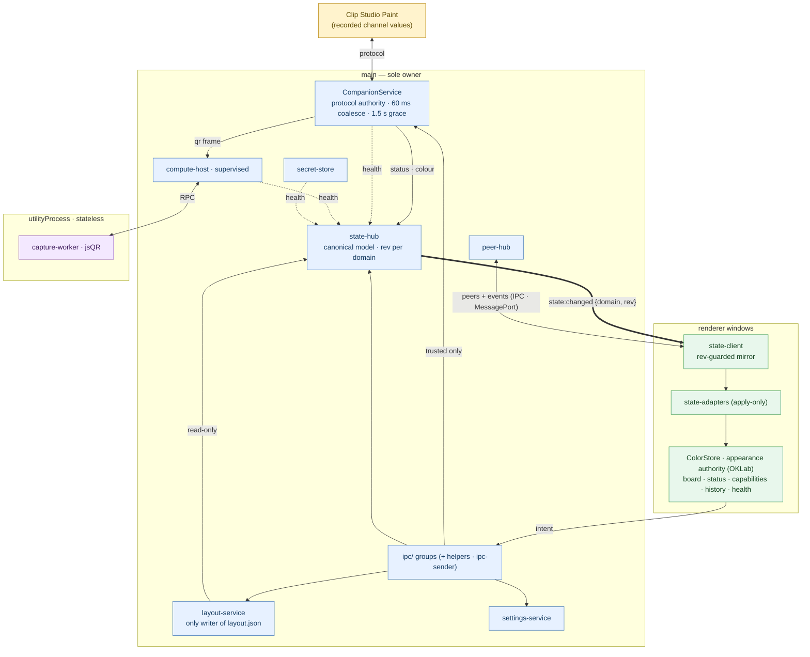
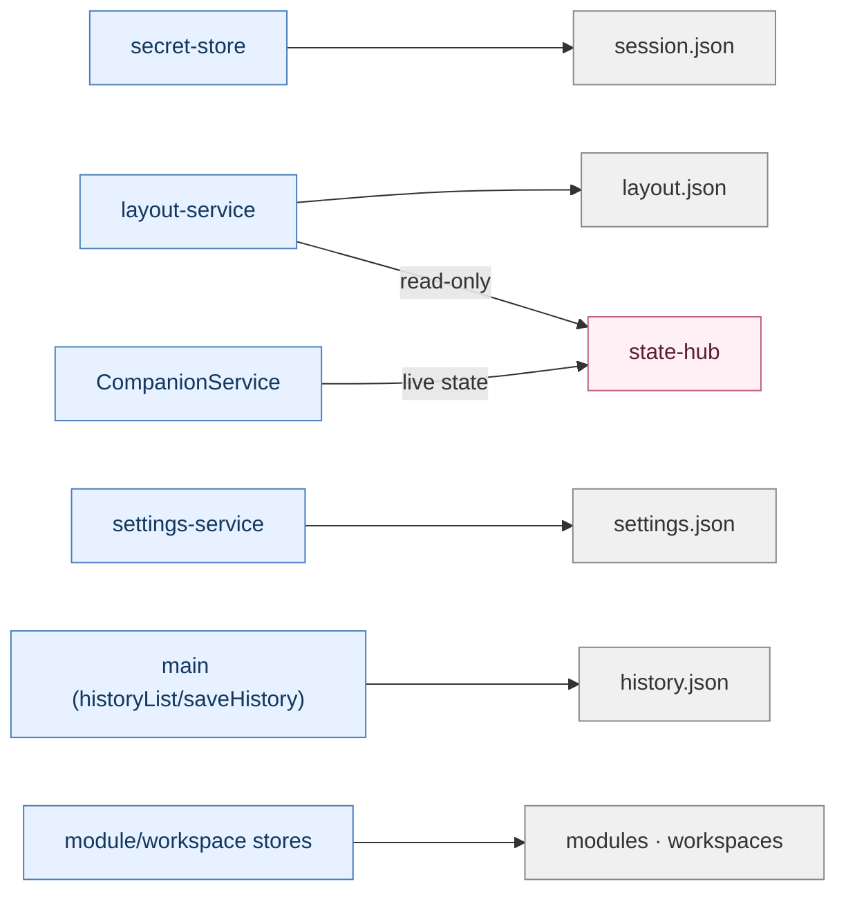

# The state model & session layer

Iroiroppa is multi-window: a palette, floats, Settings, the overlay and the module
popout are all separate windows. This document is the spec for how they share
state. It replaces the ad-hoc, hand-mirrored channels (`companion:*`,
`capabilities:changed`, `history:changed`, `layout:changed`) with **one canonical
model**, **pure per-window adapters**, and a **typed session/peer layer**.

> Status: complete and **on by default**. The model, session layer, adapters, peer
> transport, compute host and secret store are the defaults; `--legacy-state`,
> `--no-peer-bus`, `--no-compute-host` and `--no-secret-store` fall back to the old
> paths, which are kept for one release.

## The model

One versioned, serialisable envelope, owned by **main** (the only writer):

```
{ version: 1, domains: { [id]: { rev, value } } }
```

A domain is either `kind: 'tokens'` (its value is a DTCG token payload, validated)
or `kind: 'opaque'` (arbitrary JSON). The initial set (`src/shared/state-domains.js`):

| Domain | kind | owner (sole writer) | Source of truth | Adapter does |
| --- | --- | --- | --- | --- |
| `capabilities` | opaque | `capabilities` | `capabilities.js` | `capabilityStore.set(state)` |
| `connection` | opaque | `service` | `service.js` status | the status UI |
| `color` | opaque | `service` | the incoming Companion colour | the store's mirror |
| `history` | **tokens** | `main` (`history-recorder`) | main's `historyList()` | `ColorStore.setHistory(rgb)` |
| `layout` | opaque | `layout-service` | `layout-service.js` (read-only view) | the board |

The `layout` value is the whole workspace document. Each window's adapter finds its
own palette in it and hands the board `{ version: 1, columns, palette }`, where
`palette` is that window's own `{ id, name, snap, snapTo, hasFollowers, collapsed }`.
The board uses `palette` for its titlebar (name, Unsnap icon) and `columns` for the
cards; the `layout:changed` legacy push carries the same two fields.
| `health` | opaque | `main` | CSP status · compute host · secrets | diagnostics / future UI |

**Colour editing stays renderer-side.** The live colour is OKLab in `ColorStore`
(OKLab canonical, OKLCH derived); the `color` domain carries only the *incoming*
mirror, and a token carries hex only at the export edge. The history domain is a
colour collection (`history:iroiroppa`, tokens `color/01…`), converted through
`shared/color.js` so the 0–255 / 0–1 hex convention lives in exactly one place.

## Data flow

```
 window (renderer)                         main
 ─────────────────                         ────
 state.intent(name,payload) ────────────▶ intent handler ─▶ canonical model
 onStateChanged ◀──── state-hub.emit('state:changed',{domain,rev,value})
      │
      └─ adapters[domain].apply(snapshot) ─▶ view
```

Files: `src/shared/{token-model,token-schema,state-envelope,state-domains,
peer-events,transport}.js`; `src/main/{state-hub,peer-hub}.js` and
`src/main/transports/ipc-transport.js`; `src/renderer/kernel/{state-client,
peers,token-client,state-adapters}.js`. The pure cores are Electron-free and
unit-tested (`test/state-*.test.js`, `test/peer-*.test.js`,
`test/token-*.test.js`, `test/ipc-transport.test.js`).

## The session layer

`peer-hub` (main) is the source/hub; every window is a peer. It speaks the same
typed vocabulary as the token layer so the mental model transfers: `state`,
`connected`, `disconnected`, `paired`, `peer-connected`, `peer-disconnected`,
`sync`, `warning`, `error`. A peer is `{ peerId, wcId, kind, title }`. The
state machine is `idle → connected → paired → disconnected`.

Naming: the **window-peer** layer is the `peer-*` names. `session.json` and the
Companion "session" are the *pairing* — a different thing; never conflate them.

## Transports

`ipc-transport` implements the the token layer `SyncClient` lifecycle over injected
IPC: a 5 s handshake timeout, a 30 s keepalive that reaps an unresponsive peer
after 2 missed pongs, exponential backoff (1 s → 30 s), and a manual-disconnect
guard. `--peer-bus` additionally hands each window a `MessagePort` for transient
peer traffic, with the IPC path kept as the fallback. Authoritative state is always
produced by main.

## The compute host

`--compute-host` starts a supervised `utilityProcess`
(`src/main/workers/capture-worker.js`) behind a small RPC
(`src/shared/compute-protocol.js`) so heavy work (QR decode today; heavy module
work later) runs off the main thread. It is stateless and supervised; a crash
rejects only the in-flight requests. **On by default**; `--no-compute-host`
keeps the in-main decoder (`scanOnce`) available.

## The token bridge & library boundary

The token model is a **clean-room** implementation of the shared token shape:
architecture and interfaces only, no copied code, so Iroiroppa stays
`GPL-3.0-or-later`. A DTCG payload is the *interop* shape; the app's
canonical colour is never replaced by it.

**culori** (MIT) is vendored (`src/renderer/vendor/culori/`) behind
`kernel/color-interop.js`, the only module that references it. It is used only for
CSS parsing, space breadth, interpolation and colour-difference — never for the
gamut-interval core, the ICC proof transform, the canonical colour or the hex
conventions. `test/culori-crosscheck.test.js` proves the core maths agrees with
culori within 1e-4. See `THIRD_PARTY.md`.

## Flags

| Flag | Effect |
| --- | --- |
| `--legacy-state` | fall back to the legacy per-domain channels |
| `--no-peer-bus` | disable the per-window `MessagePort` peer transport |
| `--no-compute-host` | decode QR in main instead of the utility process |
| `--no-secret-store` | store the pairing secret in plaintext |

## Invariants

- **One canonical model.** Windows read from it and send intents; a window never
  hand-mirrors and never mutates the model.
- **Adapters are pure** (`canonical snapshot → view effects`) and per-window.
- **Authoritative state flows from main; peers carry transient events only.**
- **Session events are typed**; no ad-hoc status strings between windows.
- **The compute host never owns state**; it is a stateless worker behind an RPC.
- **`layout-service.js` is still the only writer of `layout.json`** — the layout
  domain is a read-only view, and intents still go through `applyLayoutIntent`.
- **Adapters apply state; they never emit intents.** A window never mutates the
  model, so there is no feedback loop.
- **A `state:changed` whose `rev` is ≤ the last applied for that domain is dropped**
  (stale/duplicate), so a delta that raced ahead of the hydrate snapshot survives.
- **The IPC entry validates its sender**: privileged channels act only for a live
  window this app owns, never on a window id taken from the payload.
- **A colour echo is suppressed only when it matches the value we wrote or the
  value we replaced** — never by time alone. Any other value is a real change (an
  eyedropper in CSP) and is accepted (`service.js`). CSP is a lossy 8-bit sink;
  the renderer's OKLab is canonical.

## Ownership & persistence

Every piece of state has exactly one owner; the hub owns only the **shared live**
state (which is never persisted by the hub itself).

| State | Sole writer | Persists | Where |
| --- | --- | --- | --- |
| canonical live model | `state-hub` | no | memory (main) |
| current colour | renderer `ColorStore` (OKLab) | via settings | — |
| colour history | main (`history-recorder` → `historyList` / `saveHistory`) | yes | `history.json` |
| workspace document | `layout-service` | yes | `layout.json` |
| settings | `settings-service` | yes | `settings.json` |
| pairing secret | `secret-store` (safeStorage) | yes | `session.json` |
| module/workspace state | module/workspace stores | yes | `modules/[id].json`, `workspaces/[id].json` |

**Colour round-trip policy.** CSP is a lossy 8-bit sink; the renderer's OKLab is
canonical. Writes are coalesced to 60 ms (`service.js`) and the final value on
pointer-up is flushed immediately. A lagging echo cannot revert the UI because the
service holds the written value for 1.5 s — but it re-asserts **only** against the
value it replaced; a value matching neither is a real change (an eyedropper in CSP)
and is accepted. See the invariant above.

## Diagrams

Runtime flow (thick arrow = the one authoritative broadcast; dashed = health):



The MessagePort handshake: main creates a `MessageChannelMain` when a window
finishes loading, keeps `port1` and transfers `port2` with
the window (`wc.postMessage('peer:port', null, [port2])`); the renderer attaches it
in `kernel/peers.js`. Each port is **window↔main** (main still mediates), and it is
closed when the window is destroyed.

Ownership & persistence (each file has one writer):



## The mutation rule

Every domain has **exactly one owning writer**; the hub is the read model that
broadcasts. Colour goes to `CompanionService`, the workspace document goes to
`layout-service`, settings to `settings-service`, and every other domain is written
by `main`. A new domain must pick an owner (see the `owner` field in
`src/shared/state-domains.js`) — do not add a second writer.

## The sender check

`ipc-sender.js` accepts a message only when its sender is a live `webContents` that
resolves to a live `BrowserWindow` of this app — a **window-instance** check (no
token, no origin). Privileged channels (`color:write`, `layout:set`, `modules:set`,
`settings:update`) also check their payload, and the guard is the **first** line of
the handler.

## IPC split

`ipc.js` is a thin `wireIpc(ctx)` that builds the shared helpers
(`ipc/helpers.js`) and registers one domain group each: `ipc/app.js`
(app/companion/proof/themes), `ipc/modules.js`, `ipc/layout.js`
(layout/workspace/palette/module instances), `ipc/window.js`
(window/drag/float/overlay/moduleSettings), `ipc/commands.js` (module commands +
shortcuts) and `ipc/settings.js` (settings/clipboard/colour/window/app). Each group
destructures the helpers it needs from `h`; `ipc-sender.js` guards the privileged
channels; `ipc/helpers.js` only delegates settings commits to `settings-service`.
The channel set is unchanged (105 handlers).

## Phases & what is pending

Phase 0 (baseline, Electron 44.6.0), Phase 1 (model + adapters + session), Phase 2
(layout view), Phase 3 (peer port), Phase 4 (compute host) and Phase 5 (secret
store) are implemented, unit-tested, and **on by default**. The compute host was
verified end-to-end (fork + RPC + jsQR worker) and every mode boot-verified. The
legacy paths are kept for one release behind the fallback flags, then deleted.
