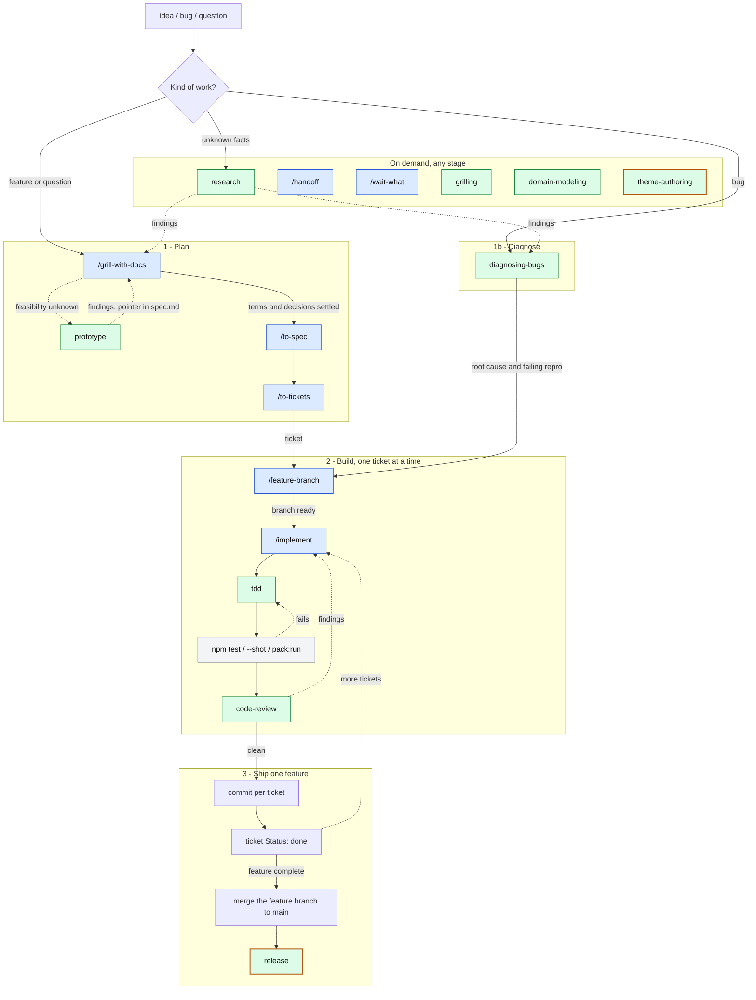
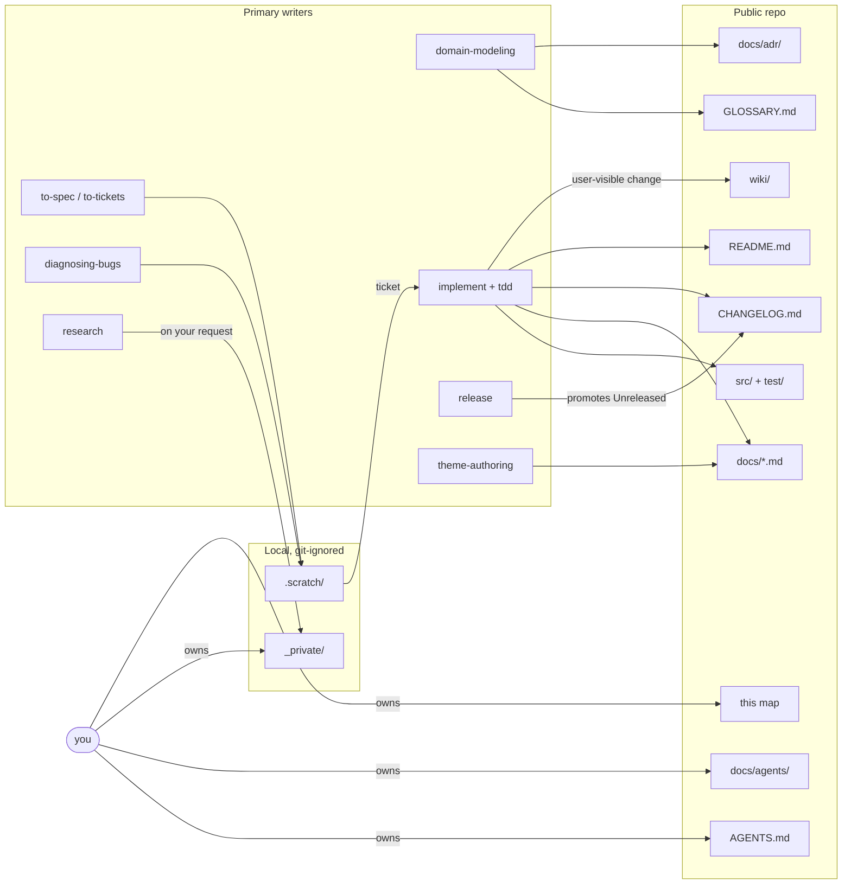

# Agent workflow map

How work flows through this repo, which skill runs each stage, and who writes
each artifact. **Descriptive, not normative**: the authority is `AGENTS.md` →
"Keeping the docs in step". Reads and writes live in the stage table (§3), not
in the arrows.

**Upkeep:** you own this map. Edit it when the cycle changes; no skill maintains
it today.

## 0. Legend

- **Solid arrow** = required order.
- **Dotted arrow** = optional step or loop-back.
- **Blue** = you invoke it (`disable-model-invocation: true`).
- **Green** = model-invoked.
- **Grey** = a command or artifact, not a skill.
- **Amber outline** = project skill, lives in `.agents/skills/`.

## 1. Lifecycle

- **One merge per feature, not per ticket.** Tickets commit one at a time on the
  same feature branch; the branch merges when the last ticket is done.
- **`/feature-branch [slug]` cuts `feat/<slug>` from `main` before the first code
  commit.** The slug is optional: after `/to-spec` the single `.scratch/<feature>/` folder supplies it.
- **Bugs skip spec and tickets.** `diagnosing-bugs` ends with a root cause and a
  failing reproduction; `/implement` consumes that in place of a ticket.
- **`/implement` calls `tdd` then `code-review` itself** — that is what enforces
  the order.
- **`release` is model-invoked but a project skill**, and still needs your
  explicit go-ahead before a tag or a major bump.
- **`/grilling` instead of `/grill-with-docs`** when you want the stress-test
  without writing glossary or ADRs.
- **`/wait-what` writes nothing** — it asks for a re-pitch in plain language
  using `GLOSSARY.md`.

## 2. On-demand skills

| Skill | Invoked by | When | Writes |
| --- | --- | --- | --- |
| `research` | model | Facts are missing while planning | `_private/research/` (private) |
| `domain-modeling` | model, usually via `/grill-with-docs` | A term or decision is settled | `GLOSSARY.md`, `docs/adr/` |
| `prototype` | model | A design question needs throwaway code | Local throwaway branch (never pushed); pointer in `spec.md` |
| `handoff` | you | A session is about to end | `%TEMP%` — outside the repo |
| `wait-what` | you | An answer did not land | Nothing |
| `grilling` | model | Stress-test a plan without the doc-writing | Nothing |
| `theme-authoring` | model | A theme or token changes | Themes, `docs/THEMES.md` |
| `setup-matt-pocock-skills` | you | One-time scaffold | `docs/agents/`, the `AGENTS.md` block |
| `inbox-triage` | you | A pile of bugs and ideas needs sorting | `_private/ROADMAP.md` → Inbox (private) |
| `implement-spec` | — | Installed, deliberately unused (§7) | — |

Rule: every installed skill appears in §1 or in this table.

An inbox line carries a marker, and moving it is the hand-off between skills:
`inbox-triage` writes `-> diagnose`, `-> implement`, `-> design` or `-> answered`;
whoever starts the work rewrites it to `-> .scratch/<feature>/`; whoever merges
rewrites it to `-> done <commit>`. Lines past triage are skipped on a re-run.

## 3. Stages: reads and writes

| Stage | Skill | Reads | Writes |
| --- | --- | --- | --- |
| Grill | `/grill-with-docs` (+ `domain-modeling`) | `AGENTS.md`, `GLOSSARY.md`, `docs/adr/`, `docs/*.md`; private research only through you | `GLOSSARY.md`, `docs/adr/` |
| Prototype | `prototype` | The grill outcome | Local throwaway branch; pointer in `spec.md` |
| Spec | `/to-spec` | `GLOSSARY.md`, `docs/adr/` | `.scratch/<feature>/spec.md` |
| Tickets | `/to-tickets` | `spec.md` | `.scratch/<feature>/issues/NN-*.md` |
| Diagnose | `diagnosing-bugs` | `AGENTS.md`, `GLOSSARY.md`, `docs/adr/`, `src/` | `.scratch/bugs/<slug>.md`; a failing test in `test/` |
| Build | `/implement` (+ `tdd`) | The ticket or diagnosis, `AGENTS.md`, `docs/*.md`, `GLOSSARY.md` | `src/`, `test/`, the owning doc, `CHANGELOG.md` under `[Unreleased]`, `README.md`, the `wiki/` page for a user-visible change |
| Review | `code-review` | The diff, `AGENTS.md`/`CONTRIBUTING.md`, the spec or ticket | Findings only, no files |
| Ship | — | — | Git history; `Status: done` in the ticket |
| Release | `release` | Commits since the tag, `CHANGELOG.md` | Version in `package.json` + lock, dated `CHANGELOG.md`, tag, release notes |

## 4. Who writes what

Primary writer only. The real exceptions, all sequential rather than concurrent:

| Artifact | Writers, in order | Why |
| --- | --- | --- |
| `CHANGELOG.md` | `implement` (`[Unreleased]`) → `release` (dated section) | The repo works in Unreleased; release promotes it |
| `test/` | `diagnosing-bugs` (failing repro) → `implement` (fix keeps it green) | The repro is the diagnosis |
| `docs/THEMES.md` | `theme-authoring` | Generated token table |
| `src/renderer/themes/` | `theme-authoring` | Bundled theme files, not application code |
| `README.md` | `implement` (user-visible change) | `release` only re-reads it |
| `AGENTS.md` block, `docs/agents/` | `setup-matt-pocock-skills` (one time) | You still approve the change |
| `wiki/` | `implement` with the change; `wiki/Glossary.md` by whoever renames the term | Same commit, both files |
| `.scratch/` | planner skills create; **you delete** the feature folder after the merge | It is ignored, so nothing else prunes it |

## 5. One home per fact

| Fact | Home | Elsewhere |
| --- | --- | --- |
| A current rule or invariant | `AGENTS.md`, one line | — |
| Why that rule exists | `docs/adr/NNNN-*.md` | A link from the `AGENTS.md` line; the ADR never restates the rule as current |
| A reversed decision | A new ADR that supersedes the old | Remove the `AGENTS.md` line in the same commit |
| Behaviour of shipped code | The owning doc (`docs/*.md`) | — |
| Behaviour still in flight | `.scratch/<feature>/spec.md` | Deleted by you at merge |
| A concept's name | `GLOSSARY.md` | `wiki/Glossary.md` updated in the same commit; it uses only user-facing wording |

## 6. The local/public boundary

Three zones, not two:

- **Public repo** — everything committed to Iroiroppa, including `wiki/`.
- **Local, git-ignored** — `.scratch/` (feature work) and `_private/` (research,
  roadmap).
- **Outside the repo** — `%TEMP%` handoff files. Temp may be cleared before the
  next session reads it; copy anything durable out first.

**No file crosses; information does**, through you: `_private/` research informs
the grill, and `.scratch/` tickets drive `/implement`, which writes `src/`. That
is intended.

- **Public files must stand alone.** No `_private/` or `.scratch/` paths, and no
  ticket numbers, in ADRs, the glossary, commits or `CHANGELOG.md`.
- **No skill ships.** `.agents/skills/` is git-ignored, so `release`,
  `theme-authoring`, `feature-branch` and `inbox-triage` exist on this machine
  only; the external skill pack lives outside this repository and is never committed. A fresh clone has neither, so
  the cycle needs the pack installed and the local skills restored.
- **`wiki/` is a normal folder in this repo**, not a separate GitHub wiki, so it
  ships in the same commit as the change.
- **Git-ignored files are absent in a worktree**, so `.scratch/` tickets do not
  exist there.
- **`main` can describe unreleased behaviour**: the feature merges to `main`
  before `/release` promotes the changelog. Accepted trade-off, not a bug.

## 7. Why `/implement`, not `/implement-spec`

`/implement-spec` runs one implementer subagent per ticket in its own worktree.
It is excluded for reasons specific to this repo:

1. `--shot` checks need a real display; a worktree run has none.
2. `pack:run` builds and launches a packaged app — slow, and it wants a clean
   output directory.
3. Parallel Electron instances collide on `%APPDATA%`, the single-instance lock
   and ports.
4. `.scratch/` is git-ignored, so tickets and specs are absent in a worktree.
5. The cycle is one ticket at a time; the parallelism worktrees buy is unwanted.
6. `node_modules` is missing too, but that is a cost, not a blocker — not the
   reason.

## 8. What the reviews changed

| Point | Outcome |
| --- | --- |
| Diagram 1 too dense | Reads/writes moved to §3 |
| Missing skills | `prototype` and `diagnosing-bugs` in §1; `research`, `handoff`, `wait-what`, `grilling`, `domain-modeling`, `theme-authoring`, `implement-spec` in §2 |
| Ownership contradictions | §4 retitled “Who writes what”, with a sequential-exceptions table |
| `REL -.-> MAP` invented | Removed; upkeep is yours |
| Diagnosis destination | §3: `.scratch/bugs/<slug>.md` plus a failing test in `test/` |
| Prototype pointer | Goes in `spec.md`, since tickets do not exist yet; branch never pushed |
| Merge cadence | §1: one merge per feature; tickets commit per ticket |
| `TEST` coloured as a skill | Grey “command” class |
| Wiki timing | Updated with the change; `main` may describe unreleased behaviour (§6) |
| Glossary drift | `wiki/Glossary.md` updated in the same commit (§5) |
| `%TEMP%` zone | Added as a third boundary zone (§6) |

## 9. Open questions

1. Should the flat `docs/*.md` split into `specs/` and `regressions/`? A good
   proposal, but it is a docs migration, not part of this map.
2. Should `GLOSSARY.md` gain a user-facing-term column so the wiki can be
   checked against it?
3. Should `release` gain a real check that this map is current and that no
   private path leaked into public files? That needs code, not prose.
