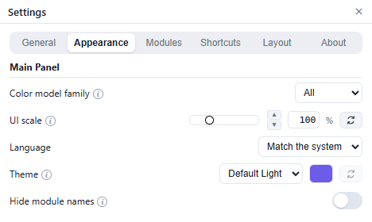

# Appearance and language

## Color model family

| Option | Effect |
| --- | --- |
| All | Show every model. |
| OKLab | Limit model lists to OKLCH and the OKLab-family shapes. |
| CIELAB | Limit model lists to CIELAB and CIELCH. |
| HelmGen | Limit model lists to HelmGen and HelmGen LCH. |

This changes the model menus only; the color stays the same.

## UI scale

Set the interface to 80–160%. Use the arrows for 1% steps or the reset button for 100%. The palette and Settings resize with the scale.

## Language

Choose **Match the system** or one of the 27 bundled languages. The palette and Settings both follow the choice.

## Theme and accent

Choose the light, dark or Blender-style theme. A theme changes colors, corners and shadows only; it does not move or resize anything. Custom themes go in the `themes` folder in Iroiroppa's data folder.

Click the swatch beside the theme to choose an accent color and **Save**. The reset button restores the theme's accent. Accents are stored per theme.

## Other options

- **Hide module names** keeps each module's title bar but hides its name.
- The **Color Slices** crosshair and lightness guide are in that module's **⋯** menu, not here.
