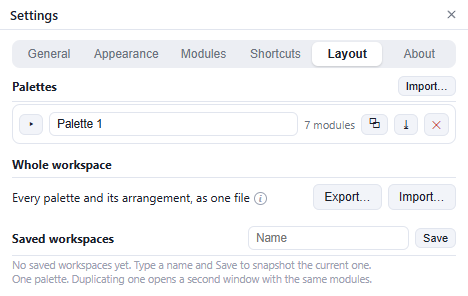

# Arrange your palette

A palette is built from **modules**: small panels that each do one job.

## Move and resize

- Drag a module by its title bar to move it.
- Drag its bottom edge to resize it.
- Click the chevron in its title bar to minimize it. Session and Color Stat are already one line and have no chevron.
- Use **Settings → Modules → Module size** for an exact height.

A module alone in a column fills it. Multiple modules split the column.

## Pop out a module

Drag a module's title bar off the palette to make it a separate window. Drag it back to return it. An empty window closes.

If a popped-out window is off-screen, use **Bring floats back on screen** in the tray menu.

## Palette menu

Click **☰** in the palette's title bar.

| Item | Action |
| --- | --- |
| **Rename…** | Name the palette. |
| **Lock layout** | Prevent moving and resizing. |
| **Settings…** | Open Settings. |
| **Delete palette…** | Delete this palette, with confirmation. |

**Unsnap** appears when palettes are joined.

## Multiple palettes

- Drag a palette over another to merge them. A confirmation prevents accidental deletion.
- Drag a palette edge against another to snap them; **Unsnap** separates them.
- **Settings → Layout** lists palettes and provides **Duplicate**, **Export** and **Delete**.

- **Import…** restores an exported palette.

## Modules and workspaces

**Settings → Modules** shows every module, whether it is mounted, and its instance controls. **Trash** removes old module settings.

**Settings → Layout** saves a named workspace and exports or imports the entire arrangement, including an old layout file.
