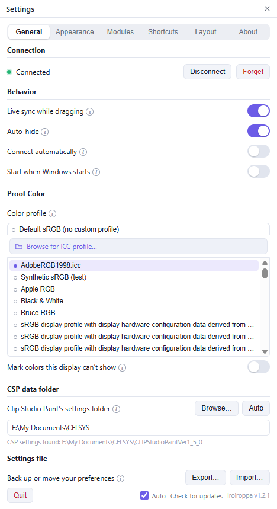

# Color profiles and gamut

Clip Studio Paint stores colors as numbers. The document's color profile gives those numbers their meaning, and it is not sent over the connection. Tell Iroiroppa the profile once for each document type.

## Set the profile

Use either:

- the **profile dropdown** in the **Session** row;
- **Settings → General → Color profile**.

Options:

- **Default sRGB (no custom profile)** — for ordinary sRGB documents.
- A profile found on your PC — pin one for quick access.
- **Browse for ICC profile…** — for another profile, including a printer profile.

On first run Iroiroppa selects the machine's **Adobe RGB (1998)** profile when available. Choose **Default sRGB** for ordinary web or digital documents.

## Proofing

Selecting a non-default profile turns on proofing: the picker previews the color through that profile, including CMYK. Proofing changes the preview only; the document's stored values are kept.

## Display warning

A wide-gamut document contains colors an sRGB monitor cannot display.

- Color maps draw those colors clipped, at full saturation.
- **Settings → General → Mark colors this display can't show** dims them instead.
- The single swatch keeps the color's lightness and reduces only its chroma.

## HEX and sRGB

**Color Stat** shows two different readings:

- **HEX** — the document's stored channel values.
- **sRGB** — the color as it appears on screen.

They differ in a wide-gamut document. Compare the same kind with the same kind.

## Common choices

| Document | Profile | Notes |
| --- | --- | --- |
| Web or ordinary digital | Default sRGB | No proofing. |
| Adobe RGB painting | Adobe RGB (1998) | Use the document's RGB profile. |
| Print | CMYK or printer profile | Use **Show out-of-gamut area** on the Color Disc to see the document's limits. |
