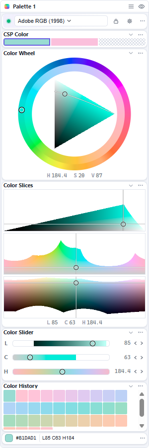

# Connect to Clip Studio Paint

Iroiroppa connects through **Companion Mode**, the same feature the official phone app uses.

## First connection

1. Open a document in Clip Studio Paint.
2. Choose **File → Connect to smartphone**. A QR code appears.
3. Leave the QR code visible. Iroiroppa scans for it automatically.
4. The **Session** dot turns green. Hover it to confirm “Connected to Clip Studio Paint”.

The pairing is remembered and reconnects on later launches.

## If it does not connect

| Try this | How |
| --- | --- |
| Retry the connection | Click the **Session** dot, or use **Settings → General → Connect**. |
| Scan a fresh QR code | Right-click the tray icon and choose **Connect (scan QR)...**. |
| Paste the QR text | Use the **or paste QR URL / hex payload** box in **Settings → General**. |
| Re-pair | Use **Forget pairing** in the tray or **Settings → General**, then connect again. |

Only one phone-side connection is allowed at a time. Close the official phone app, or another copy of Iroiroppa, before connecting.

## Connection states

| State | Meaning |
| --- | --- |
| **Disconnected** | Not connected and not trying. |
| **Scanning…** | Looking for the QR code. |
| **Connecting…** | QR found; opening the connection. |
| **Reconnecting…** | A remembered connection is being retried. |
| **Pairing failed** | The QR was rejected. Open a fresh QR code and pair again. |

## Disconnect

- **Disconnect** keeps the pairing for next time.
- **Forget pairing** removes it.

Both are in the tray menu and **Settings → General**. **Disconnect** is also in the Session row's **⋯** menu.

## Screen reading

Iroiroppa reads the screen only to find the QR code, locally. It does not save or upload the image. Turn off **Connect automatically** in **Settings → General** to stop the scan.
