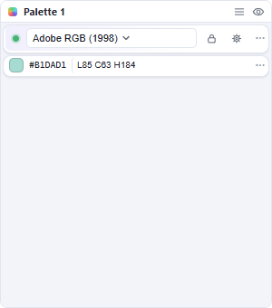
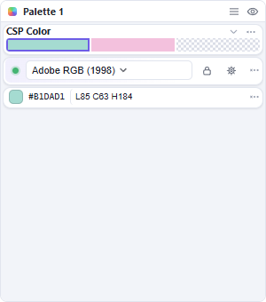
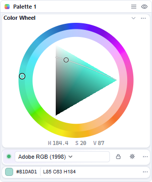
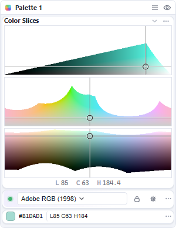
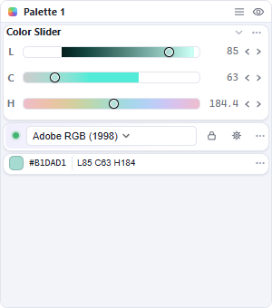
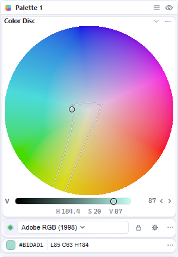
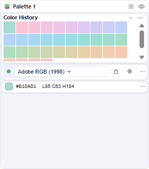
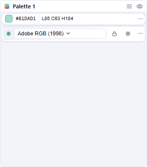
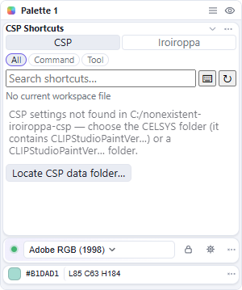

# Module list

Every module does one job. Add, duplicate, hide or remove a module in **Settings → Modules** (see [Customize your palette](Customize-your-palette.md)).

## Session

- **Dot** — connection state. Click to connect or retry; hover for the full state.
- **Profile dropdown** — the document's color profile.
- **Lock** — prevents layout changes.
- **Gear** — opens Settings.
- **⋯** — disconnect or forget the pairing.

## CSP Color

Clip Studio Paint's **Foreground**, **Background** and **Transparent** slots. Click a slot to choose where picks are written.

## Color Wheel

A hue ring around a shaped middle. Use **⋯** for the inner shape, ring width, hue rotation, rotate and flip.

## Color Slices

Three flat maps: hue, lightness and chroma slices. Use **⋯** to reorder or hide maps, rotate or flip them, and toggle the lightness guide or crosshair.

Hold **Shift** while dragging to keep the current lightness.

## Color Slider

Lightness, chroma and hue rows. Use **⋯** for thickness, orientation and value visibility.

## Color Disc

Hue and chroma on a circle, with a lightness row below. **Show out-of-gamut area** marks colors the document cannot hold; a drag outside the disc stops at the nearest valid color.

## Color History

Recent colors, newest first. Click a tile to reuse it. Stored locally in `history.json`.

## Color Stat

The current color's HEX, channel values and sRGB appearance. Click the left half of HEX to copy, the right half to paste, or double-click to type.

## CSP Shortcuts

Search and run Clip Studio Paint's commands and tools. Use **All**, **Command** or **Tool** to filter; click a row to run it.

- Reads the **current workspace** (`workspace_*.spws`), not a factory list.
- Press **↻** after saving the workspace or closing Clip Studio Paint.
- Set the CSP data folder with **Locate CSP data folder…** or **Settings → General**.
- Bind a key from the module's **⋯** menu.
- Commands need Clip Studio Paint in front and ready for input.

## Models

Each picker has a **Model** option in its **⋯** menu. **OKHSV** and **OKHSL** use the document's RGB profile; in a CMYK document choose **OKLCH** or **HelmGen LCH**. See [Color profiles and gamut](Color-profiles-and-gamut.md).
