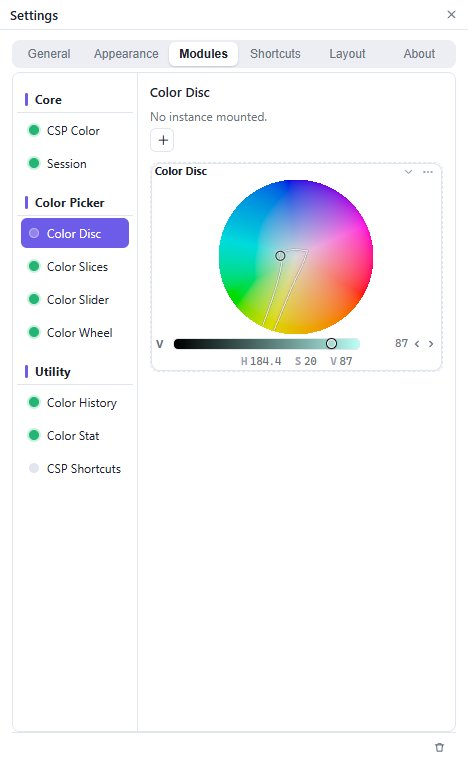

# Settings

Open Settings from the **Session** row's gear, the palette's **☰** menu, the tray icon, or a module's **⋯** menu.

## Tabs

| Tab | Contents |
| --- | --- |
| **General** | Connection, behavior, color profile, CSP data folder, settings backup, updates. |
| **Appearance** | Theme, accent color, UI scale, language, model family. See [Appearance and language](Appearance-and-language.md). |
| **Modules** | Mount, hide, duplicate, size and delete module instances. |
| **Shortcuts** | Show/hide, hold and after-pick keys, and window placement. |
| **Layout** | Palettes and workspaces. See [Customize your palette](Customize-your-palette.md). |
| **About** | Version, links, credits, license and third-party notices. |

## General

### Connection

The status, **Connect**, **Reconnect** and **Forget**. The **or paste QR URL / hex payload** box is for setups where screen reading fails.

### Behavior

| Option | Default | Effect |
| --- | --- | --- |
| Live sync while dragging | on | Send colors while dragging; off sends on release. |
| Auto-hide | on | Show the palette while Clip Studio Paint is in front. |
| Connect automatically | on | Scan for Clip Studio Paint's QR code while disconnected. |
| Start when Windows starts | off | Launch Iroiroppa at sign-in. |

### Proof Color

Set the document profile and choose whether to dim colors the display cannot show. See [Color profiles and gamut](Color-profiles-and-gamut.md).

### CSP data folder

The folder containing `CLIPStudioPaintVer…`, used by the [CSP Shortcuts module](Module-List.md). **Auto** restores the usual location.

### Settings file

**Export…** backs up preferences; **Import…** restores them. For a complete backup, copy the data folder described in [Reset, uninstall and back up](Reset-uninstall-and-backup.md).

### Updates

The footer contains **Auto**, **Check for updates**, the version and **Quit**.

- **Auto** checks at startup and once a day.
- When an update exists: **Quit & install** (installer) or **Replace & relaunch** (portable).

## Modules

The module list is grouped into **core**, **picker** and **utility**. Each row can be mounted, hidden, added as another instance, sized under **Module size**, previewed and deleted. **Trash** and **Remove unused settings files** remove leftovers.

Session and CSP Color are singletons and cannot be duplicated.

## Shortcuts

See [The tray icon and the hotkey](Tray-and-hotkey.md) for the three reveal modes and placement.

## Layout

Manage palettes and saved workspaces. See [Customize your palette](Customize-your-palette.md).

## About

Shows the version and build, repository and guide links, author, credits, license and third-party notices. **What's new** reopens the current release note; **Check for updates** reports the latest release.
