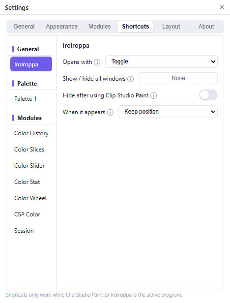

# The tray icon and shortcuts

With **Auto-hide** on, Iroiroppa is visible only while Clip Studio Paint is in front. It is still running when the palette disappears.

## Restore the palette

1. Click into Clip Studio Paint.
2. Or right-click the tray icon (near the clock) and choose **Show / hide palette**.
3. Or press the show/hide shortcut, if one is set.

## Tray menu

| Item | Action |
| --- | --- |
| **Show / hide palette** | Toggle the palette. |
| **Bring floats back on screen** | Recover popped-out modules. |
| **Settings…** | Open Settings. |
| **Reconnect** | Retry the saved connection. |
| **Connect (scan QR)...** | Show the palette and scan a fresh QR code. |
| **Disconnect** | Drop the connection but keep the pairing. |
| **Forget pairing** | Delete the pairing. |
| **Quit** | Exit Iroiroppa. |

## Turn off Auto-hide

Open **Settings → General → Auto-hide** and switch it off. Iroiroppa then stays visible until you hide it, without taking focus from other programs.

## Set a shortcut

1. Open **Settings → Shortcuts**.
2. Select **General → Iroiroppa**.
3. Click **Show / hide all windows** and press the key.

Press **Esc** to clear a binding. A single key or an F-key works; single keys are ignored while you are typing.

Shortcuts act only while Clip Studio Paint or an Iroiroppa window is active. If a key is unavailable, another program owns it.

## Reveal modes

| Mode | Behavior |
| --- | --- |
| **Toggle** | Press to show; press again to hide. Optionally hide after the next Clip Studio Paint click. |
| **Hold** | Show while the key is held; restore the previous state on release. |
| **After color pick** | Plain **Alt + left-click** on the canvas samples the color, then shows the target. The next stroke, or 8 seconds, closes it. |

**When it appears** can keep the remembered position or place the window at the pointer. Ctrl+Alt and Shift+Alt are ignored.

## Start with Windows

Enable **Settings → General → Start when Windows starts**.

## Quit

Closing the palette does not quit Iroiroppa. Use **Quit** in the tray or Settings.
